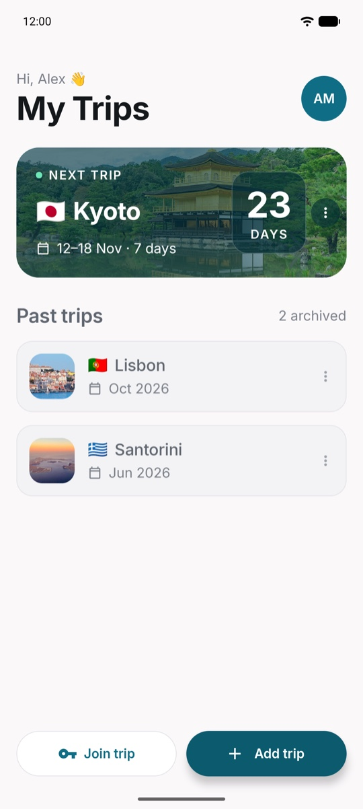
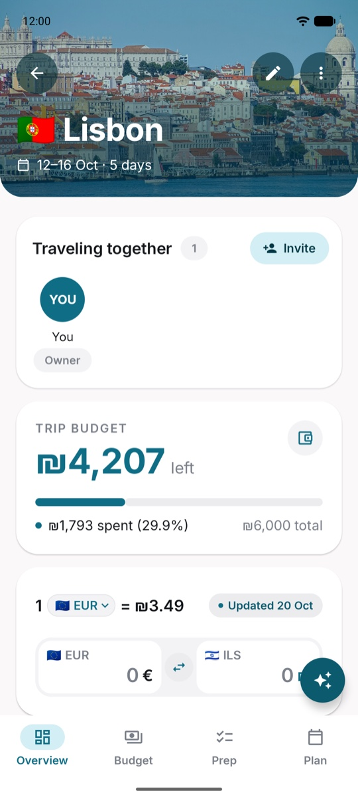
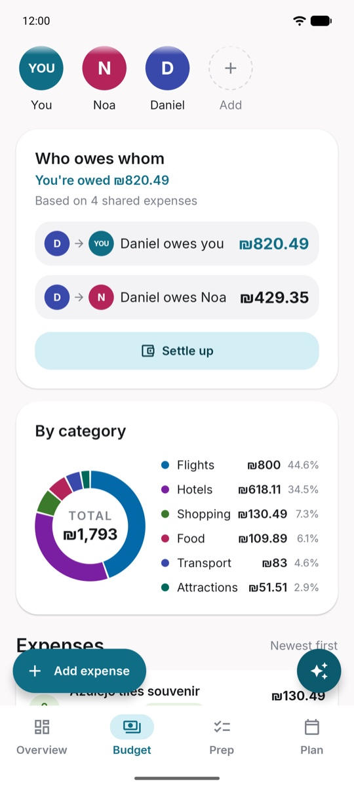
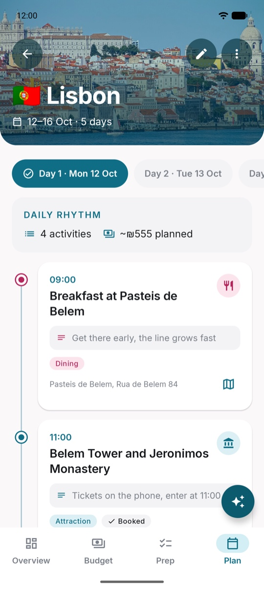
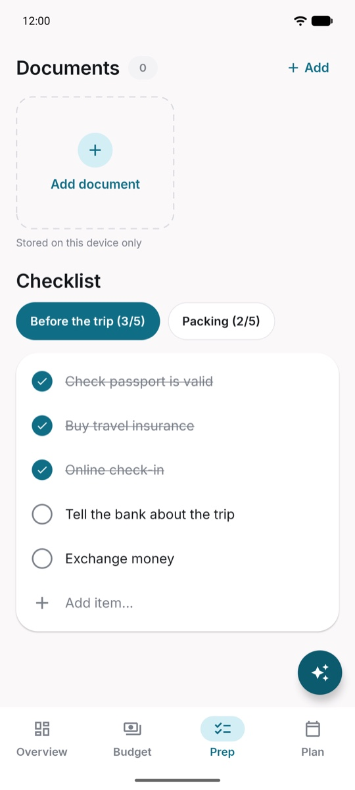
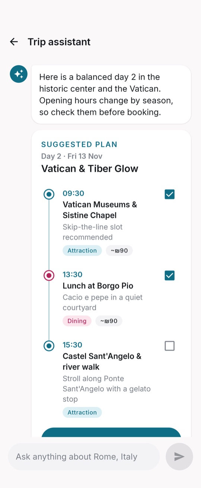
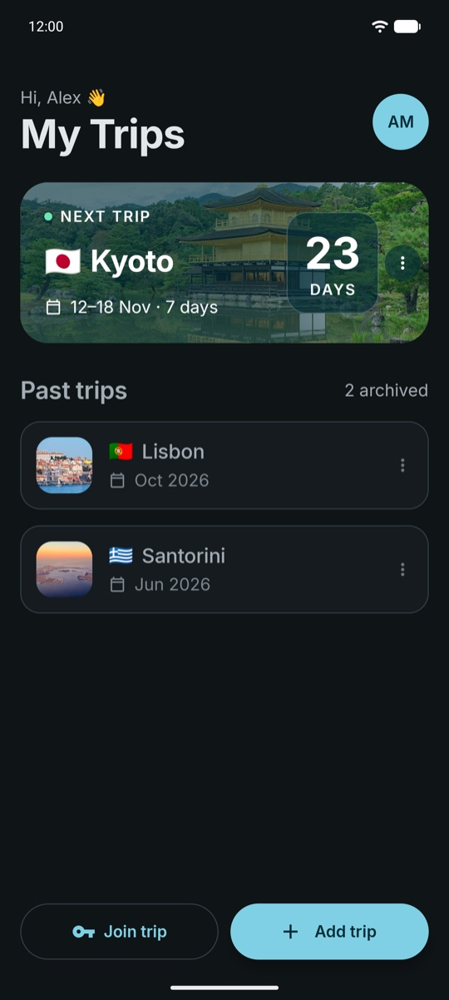
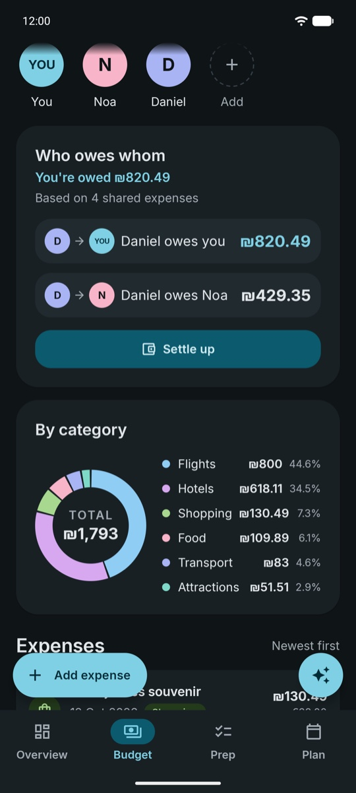
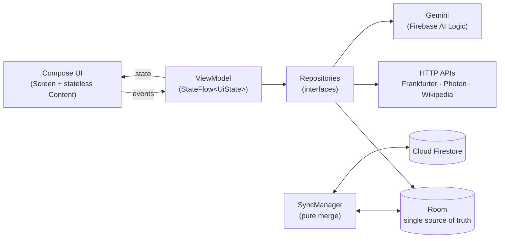

# ✈️ Plan Your Trip – Group Trip Planner for Android

**An offline-first Android trip planner for groups: shared trips, split expenses, multi-currency budgets, a day-by-day
itinerary and an AI trip assistant.**


**Plan Your Trip** is an Android app built with **Kotlin** and **Jetpack Compose**. It keeps a whole trip in one place:
who's coming, what everything costs, who owes whom, what to do each day and what to pack.

The app is **offline-first**. Everything is stored on the device in **Room** and synced with **Cloud Firestore**, so it
works without a connection and every traveler on a shared trip sees the same plan.

---

# 🚀 Core Features

- 👥 **Shared Trips** – Invite up to 10 people with single-use, 7-day invite codes
- 💸 **Expense Splitting** – Split each expense, see who owes whom with the fewest transfers, and settle up
- 💱 **Multi-Currency** – Expenses in ILS or the local currency, with live exchange rates cached for offline use
- 📊 **Personal Budget** – What's left and spending by category, counting only your own share
- 🗓️ **Daily Itinerary** – A timeline for each day, with links to open each place in Google Maps
- ✅ **Prep Checklists & Documents** – A shared "Before the trip" list, a personal packing list, and travel documents
- 🤖 **AI Trip Assistant** – Gemini answers questions and suggests day plans you can add in one tap
- 🔔 **Reminders** – A notification at 18:00 the evening before a trip starts
- ☁️ **Offline-First Sync** – Works without a connection and syncs when the device is back online
- 🌙 **Dark Mode** – A full dark theme

---

# 🔄 Application Flow

`Sign In / Sign Up` ➝ `Home` ➝ `Trip` ➝ `Overview` / `Budget` / `Prep` / `Plan` ➝ `AI Assistant`

---

# 📱 Screens Breakdown

## 🔐 Sign In & Sign Up

**Purpose:**  
Create an account or sign in, so your trips sync to every device you use.

**Overview:**
- Separate **Sign In** and **Sign Up** screens
- Email & password authentication with Firebase
- Fields are checked when you submit, and Firebase errors are shown as clear messages
- A password strength meter on Sign Up
- What you've typed survives the app being closed in the background

---

## 🏠 Home

**Purpose:**  
The central hub for all your trips.

**Overview:**
- The next trip is a large card with a destination photo and a day countdown
- Upcoming and past trips, each with its flag and dates
- A three-dot menu on each trip to share it as a PDF or delete or leave it
- Swipe a trip left to delete it, and pull down to refresh
- **Add trip** and **Join trip** (with an invite code) buttons

<p align="center"></p>

---

## 🧭 Trip Overview

**Purpose:**  
A quick summary of the trip at a glance.

**Overview:**
- A header with the destination photo, flag, dates and a countdown
- **Traveling together:** the members of the trip, and an **Invite** button
- A budget card showing what's left
- A currency converter with the latest exchange rate
- Bottom tabs: **Overview, Budget, Prep, Plan**, plus the ✨ assistant button

<p align="center"></p>

---

## 💸 Budget & Split

**Purpose:**  
Track spending and keep the group's money fair.

**Overview:**
- A personal budget with a progress bar; only your share of shared expenses counts
- Travelers can be added by name, without an account
- **Who owes whom**, with the fewest possible transfers, and a **Settle up** button
- A spending donut by category
- Expenses in ILS or a foreign currency; each expense keeps the rate from its first save

<p align="center"></p>

---

## 🗓️ Daily Plan

**Purpose:**  
Plan each day of the trip.

**Overview:**
- Day chips and a timeline of activities with times
- An activity type, notes, a planned cost and a "Booked" status on each activity
- A daily summary with the number of activities and the planned spending
- A link to open each place in Google Maps
- Activities that fall outside the trip dates are kept, never deleted

<p align="center"></p>

---

## ✅ Prep

**Purpose:**  
Make sure nothing is forgotten before you leave.

**Overview:**
- Progress across all the checklist items
- **Before the trip:** a checklist shared with the group
- **Packing:** a personal list for each traveler
- Travel documents (PDF or images up to 20 MB), stored only on this device

<p align="center"></p>

---

## 🤖 AI Trip Assistant

**Purpose:**  
Get ideas and answers about the trip.

**Overview:**
- A chat with Gemini that knows the trip's destination and dates
- Suggested day plans, with a checkbox to pick each activity
- Chosen activities are added to the itinerary in one tap
- The chat is kept only in memory and never stored

<p align="center"></p>

---

# 🌙 Dark Mode

Every color in the app has a dark version.

<p align="center">
  
  &nbsp;&nbsp;
  
</p>

---

# ☁️ Firebase Integration

## 🔐 Firebase Authentication
- Email & password sign-in and sign-up
- Each account's data is kept separate on the device and in the cloud

## 🗄 Cloud Firestore
- Trips, expenses, travelers, settlements, activities and checklists
- Shared trips with members, invite codes, and private data for each member (budget, packing list)
- Security rules limit each trip to its members and validate the data written

## 🛡 Firebase App Check
- Only the real app can call the AI backend (Play Integrity in release builds, a debug provider in debug builds)

## ✨ Firebase AI Logic
- Gemini answers as structured JSON, which becomes suggested day plans

---

# 🏗️ Architecture

The app has one Activity and uses MVVM with unidirectional data flow. Each screen collects an immutable UI state from
its ViewModel's `StateFlow` and sends events back as lambdas. ViewModels depend on repository **interfaces**, which
are wired up by hand in an `AppContainer` (no DI framework). Only a few classes import Firebase or call the network,
so tests can swap in fakes for all of them.



**Offline-first sync.** Screens read only from Room, so the app never waits on the network. Each synced row has a
stable `uuid`, an `updatedAt` time and a `pending` flag. About a second after a local change, a *quick sync* uploads
the pending rows. A *full sync* runs on sign-in, when the app comes to the foreground and on pull-to-refresh. The
merge is a pure function: it matches rows by uuid, and the newer `updatedAt` wins. Deletions are stored as
**tombstones**, so a deleted item can't come back from another device.

---

# 🧪 Testing & CI

- 🧩 **~940 JVM unit tests** for ViewModels, the merge and sync logic, split math, money, formatting and parsing,
  all using fakes with an injected `Clock` and dispatchers
- 🔒 **92 Firestore security rules tests** on the Firebase Emulator, covering members, invites and field validation
- 🗃️ **Room migration tests** (schema v1 → v17) that check no data is lost, plus DAO tests
- 📸 **Screenshot tests:** a baseline of every `@Preview` for before/after comparisons, and layout checks at 320dp
  with 1.5× font scale
- ⚙️ **CI on every push and PR** (GitHub Actions): unit tests, lint (zero warnings), debug and R8 release builds, and
  the rules tests
- 💰 **Money is never a float:** amounts are stored as whole agorot in a `Long`, and split shares always add up exactly
  to the total

---

# 🛠️ Technologies Used

- **Language:** Kotlin
- **UI:** Jetpack Compose, Material 3, Navigation Compose (type-safe routes)
- **Local data:** Room (with migrations and exported schemas)
- **Backend:** Firebase (Authentication, Cloud Firestore, App Check, AI Logic / Gemini)
- **Background work:** WorkManager and AlarmManager
- **Networking & images:** OkHttp, Coil, kotlinx.serialization
- **APIs:** Frankfurter (exchange rates), Photon (place search), Wikipedia (destination photos)
- **Build:** Gradle version catalog, R8 shrinking for release builds, GitHub Actions

---

# ▶️ Build & Run

Requirements: Android Studio (recent), JDK 21, Android SDK 36. The app runs on Android 8.0 (API 26) and up.

```bash
./gradlew assembleDebug        # debug APK
./gradlew testDebugUnitTest    # unit tests
./gradlew lintDebug            # lint
./gradlew assembleRelease      # R8-shrunk release APK (unsigned)

# Firestore rules tests (Firebase Emulator, no real project)
cd rules-tests && npm install && npm test
```

The app is connected to the author's Firebase project through `app/google-services.json`. To run it against your
own backend, create a Firebase project with Email/Password Auth, Firestore and AI Logic, then replace that file and
publish `firestore.rules`. For App Check in debug builds, register the debug token that the app logs on its first run.

---